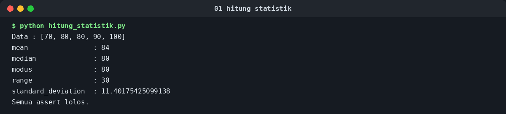
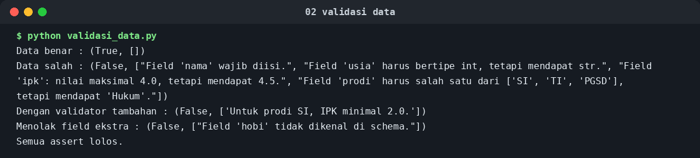
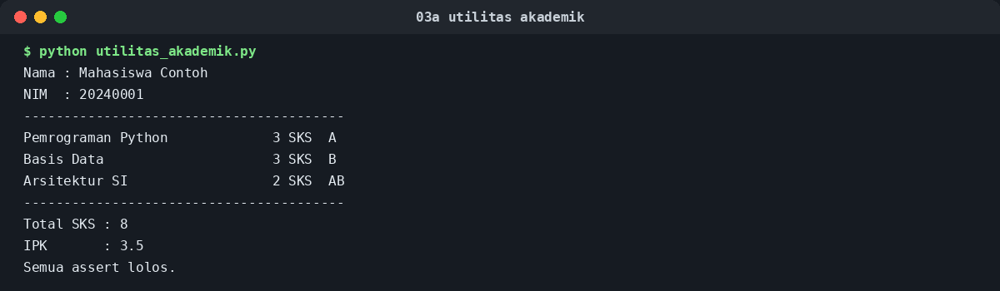
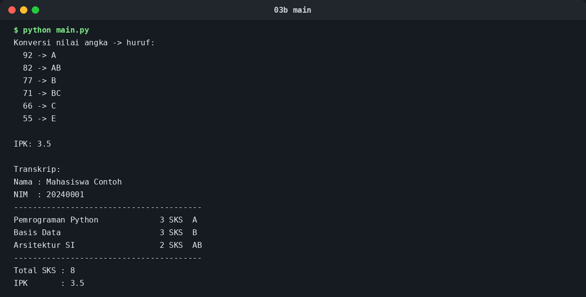
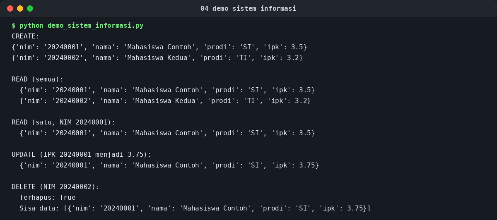
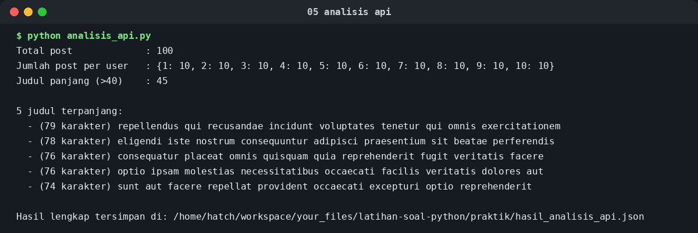

# Latihan Soal Python — Jawaban Soal dan Hasil Terminal

Dokumen ini berisi jawaban lengkap latihan soal: 5 soal teori dan 5 soal
praktik tentang fungsi, scope, modul, dan package dalam Python.

Semua kode praktik sudah dijalankan ulang dan hasilnya direkam apa adanya.
Tangkapan terminal di bawah ini dibuat dari output asli tersebut (hanya
baris yang sangat panjang yang terbungkus, seperti di jendela terminal
biasa). Salinan teks outputnya juga tersimpan di folder `outputs/`,
dan gambarnya di folder `screenshots/`, supaya bisa diperiksa
baris per baris.

Jawaban yang lebih panjang, dengan kode lengkap tiap praktik, juga ada di
`../Jawaban_Latihan_Soal_Python.pdf`.

---

## A. Soal Teori

### Teori 1. Perbedaan Parameter dan Argumen

**Parameter** adalah variabel yang ditulis di dalam definisi fungsi. Ia
berperan sebagai tempat penampung: namanya sudah ditentukan, tetapi
nilainya belum ada sampai fungsi dipanggil. **Argumen** adalah nilai nyata
yang dikirimkan pada saat pemanggilan fungsi, dan nilai itulah yang
kemudian diikat ke parameter yang bersangkutan.

| Aspek | Parameter | Argumen |
| --- | --- | --- |
| Letaknya | Di definisi fungsi | Di pemanggilan fungsi |
| Sifatnya | Nama variabel penampung | Nilai nyata (literal, variabel, atau ekspresi) |
| Waktunya | Ditetapkan saat fungsi ditulis | Diberikan saat fungsi dijalankan |

```python
def sapa(nama, pesan="Halo"):   # nama dan pesan adalah parameter
    print(f"{pesan}, {nama}!")

sapa("Dina")                    # "Dina" adalah argumen
sapa("Rani", "Selamat pagi")    # argumen positional, sesuai urutan
sapa(nama="Budi", pesan="Hai")  # argumen keyword, disebut namanya
```

Parameter `pesan` memiliki nilai default `"Halo"`, sehingga
`sapa("Dina")` tetap sah tanpa argumen kedua.

### Teori 2. Aturan LEGB dalam Scope Python

Ketika Python menemukan sebuah nama variabel, ia mencarinya dari scope
yang paling dalam ke yang paling luar, dengan urutan **LEGB**:

- **Local (L):** scope di dalam fungsi yang sedang berjalan.
- **Enclosing (E):** scope fungsi pembungkusnya, untuk fungsi bersarang.
- **Global (G):** scope tingkat modul, yaitu variabel di luar semua fungsi.
- **Built-in (B):** nama bawaan Python seperti `print`, `len`, dan `str`.

Pencarian berhenti pada scope pertama yang memiliki nama itu. Karena itu,
variabel lokal dapat "menutupi" variabel global yang namanya sama, tanpa
mengubah nilai global tersebut. Jika nama itu tidak ditemukan di mana pun,
terjadilah `NameError`.

```python
x = "global"  # G

def luar():
    x = "enclosing"  # E

    def dalam():
        x = "local"  # L
        print("local:", x)
        print("built-in len:", len("abc"))  # B: len adalah nama bawaan

    dalam()
    print("enclosing:", x)

luar()
print("global:", x)
```

Keluaran program di atas adalah `local`, lalu `enclosing`, lalu `global`,
masing-masing sesuai scope tempat nama itu dibaca. Membaca variabel dari
scope luar itu mudah, tetapi mengubahnya tidak: assignment di dalam fungsi
selalu membuat variabel lokal, kecuali dinyatakan dulu dengan `global`
(untuk scope modul) atau `nonlocal` (untuk scope enclosing). Tanpa
pernyataan itu, membaca variabel global sebelum di-assign di dalam fungsi
yang sama menghasilkan `UnboundLocalError`.

Contoh membaca enclosing tanpa menutupinya:

```python
def luar():
    y = 10  # enclosing
    def dalam():
        print(y)  # tidak ada y lokal, jadi dibaca dari enclosing
    dalam()

luar()  # mencetak 10
```

### Teori 3. Objek Mutable sebagai Default Parameter: Sebuah Pitfall

Menggunakan list atau dictionary sebagai nilai default parameter adalah
jebakan klasik, karena kodenya tampak benar pada pemanggilan pertama,
lalu salah pada pemanggilan berikutnya:

```python
def tambah(item, daftar=[]):
    daftar.append(item)
    return daftar

print(tambah(1))  # [1]    -> tampak benar
print(tambah(2))  # [1, 2] -> seharusnya [2] jika daftar baru tiap panggilan
```

**Mekanismenya:** nilai default dievaluasi sekali saja, yaitu pada saat
pernyataan `def` dieksekusi, bukan pada setiap pemanggilan fungsi. Nilai
default itu kemudian disimpan di dalam objek fungsi itu sendiri
(di atribut `__defaults__`). Karena `daftar` adalah objek mutable, semua
pemanggilan yang tidak mengirim argumen `daftar` berbagi objek list yang
sama, sehingga setiap `append` menumpuk isinya dari satu panggilan ke
panggilan berikutnya.

Jebakan ini tidak terjadi pada default yang immutable (angka, string,
tuple), karena objek immutable tidak bisa diubah di tempat. Solusi yang
benar adalah memakai `None` sebagai penanda, lalu membuat objek mutable
baru di dalam badan fungsi:

```python
def tambah(item, daftar=None):
    if daftar is None:
        daftar = []  # list baru dibuat pada setiap panggilan
    daftar.append(item)
    return daftar

print(tambah(1))  # [1]
print(tambah(2))  # [2]
```

Dengan cara ini, pemanggil yang memang ingin mengakumulasi hasil masih
bisa mengirim listnya sendiri secara eksplisit, tetapi pemanggil yang
tidak mengirim apa pun selalu mendapat list baru yang kosong.

### Teori 4. Perbedaan Modul dan Package, serta Peran `__init__.py`

**Modul** adalah satu file Python berekstensi `.py`. Setiap file itu
adalah satu namespace: fungsi, kelas, dan variabel di dalamnya bisa
diimpor file lain. **Package** adalah direktori yang mengelompokkan
beberapa modul (dan bisa juga subpackage) menjadi satu kesatuan yang
hierarkis, sehingga kode yang besar tidak menumpuk dalam satu file.

| Aspek | Modul | Package |
| --- | --- | --- |
| Bentuknya | Satu file `.py` | Satu direktori berisi modul-modul |
| Cara import | `import nama_modul` | `import nama_package.nama_modul` |
| Contoh | `utilitas_akademik.py` | `sistem_informasi/` dengan subpackage `model`, `service`, `utils` |

Peran file `__init__.py` dalam sebuah package ada tiga. Pertama, ia
adalah penanda bahwa direktori tersebut adalah package, dan ia dieksekusi
pertama kali saat package diimpor. Kedua, ia dapat dipakai untuk
menjalankan kode inisialisasi package. Ketiga, ia dapat mengekspos API
package supaya pemakai tidak perlu menghafal struktur dalamnya, misalnya
dengan menulis `from .service.mahasiswa_service import MahasiswaService`
di dalam `__init__.py`, sehingga pemakai cukup menulis
`from sistem_informasi import MahasiswaService`. File ini boleh kosong
dan tetap sah; kekosongan itu hanya berarti package tidak melakukan
inisialisasi khusus.

### Teori 5. Kapan Menggunakan `lambda` dan Kapan Menggunakan `def`

Fungsi `lambda` adalah fungsi anonim yang terdiri dari satu ekspresi
saja; nilainya langsung menjadi nilai kembalian, tanpa pernyataan
`return`. Fungsi `def` adalah fungsi bernama yang badannya berupa blok
pernyataan, sehingga bisa berisi banyak baris, percabangan, perulangan,
penanganan error, docstring, dan anotasi tipe.

**Tiga skenario di mana `lambda` lebih tepat:**

1. Sebagai argumen sekali pakai untuk higher-order function, misalnya
   key pada `sorted`, karena fungsinya hanya mengambil satu field:
   `sorted(mahasiswa, key=lambda m: m["ipk"], reverse=True)`.
2. Di dalam `map` dan `filter` untuk operasi satu baris yang maknanya
   langsung terlihat, misalnya `list(map(lambda x: x * 2, [1, 2, 3]))`
   dan `list(filter(lambda x: x % 2 == 0, [1, 2, 3, 4]))`.
3. Sebagai callback atau kunci sederhana yang tidak akan dipakai di
   tempat lain, di mana memberi nama justru menambah baris tanpa
   menambah kejelasan.

**Tiga skenario di mana `def` lebih tepat:**

1. Logika yang terdiri dari banyak langkah, misalnya validasi bertahap
   atau percabangan bercabang. `lambda` tidak bisa berisi pernyataan
   seperti blok `if`, loop, atau `try-except`.
2. Fungsi yang dipakai berulang, perlu diuji sendiri, atau akan muncul
   di traceback saat error. Nama yang jelas membuat error lebih mudah
   dilacak, sedangkan `lambda` di traceback hanya tampil sebagai
   `<lambda>`.
3. Fungsi yang butuh dokumentasi (docstring), anotasi tipe, atau
   dekorator. Semua itu adalah fasilitas `def`, bukan `lambda`.

Aturan praktis dari PEP 8: jangan mengikat `lambda` ke sebuah nama
variabel (misalnya `kuadrat = lambda x: x ** 2`), karena itu hanya `def`
yang ditulis lebih buruk. Jika sebuah fungsi cukup penting untuk diberi
nama, tulislah dengan `def`.

---

## B. Soal Praktik — Hasil Terminal Tiap Kode

Semua perintah di bawah dijalankan dari folder `praktik/` ini.

### Praktik 1. Fungsi `hitung_statistik()`

File: `hitung_statistik.py`. Fungsi ini menerima list angka dan
mengembalikan dictionary berisi mean, median, modus, range
(max − min), dan standard deviation, hanya dengan standard library
(`statistics`). Modus dicari dengan `statistics.multimode`, dan
standard deviation memakai `statistics.stdev` (simpangan baku sampel;
untuk satu data nilainya 0,0). List kosong ditolak dengan `ValueError`.

```bash
python hitung_statistik.py
```



```text
$ python hitung_statistik.py
Data : [70, 80, 80, 90, 100]
mean                : 84
median              : 80
modus               : 80
range               : 30
standard_deviation  : 11.40175425099138
Semua assert lolos.
```

Hitung manualnya cocok: mean (70+80+80+90+100)/5 = 84, median adalah
nilai tengah setelah diurutkan, modus 80 karena muncul dua kali, dan
range 100−70 = 30.

### Praktik 2. Fungsi `validasi_data()`

File: `validasi_data.py`. Fungsi ini menerima dictionary data dan
dictionary schema, lalu mengembalikan tuple `(is_valid, errors)`.
Schema menyatakan tipe yang diharapkan, apakah field itu wajib, rentang
nilai untuk angka atau rentang panjang untuk string/list, daftar nilai
yang diperbolehkan (`choices`), dan pola regex opsional. Fleksibilitas
tambahan sesuai soal: `*args` menampung fungsi validator tambahan, dan
`**kwargs` menampung opsi seperti `allow_extra=False` untuk menolak
field yang tidak ada di schema. Pemeriksaan tipe juga menangani
kekhususan Python bahwa `bool` adalah subclass `int`, sehingga `True`
tidak lolos sebagai `int`.

```bash
python validasi_data.py
```



```text
$ python validasi_data.py
Data benar : (True, [])
Data salah : (False, ["Field 'nama' wajib diisi.", "Field 'usia' harus bertipe int, tetapi mendapat str.", "Field 'ipk': nilai maksimal 4.0, tetapi mendapat 4.5.", "Field 'prodi' harus salah satu dari ['SI', 'TI', 'PGSD'], tetapi mendapat 'Hukum'."])
Dengan validator tambahan : (False, ['Untuk prodi SI, IPK minimal 2.0.'])
Menolak field ekstra : (False, ["Field 'hobi' tidak dikenal di schema."])
Semua assert lolos.
```

### Praktik 3. Modul `utilitas_akademik.py` dan File `main.py`

File: `utilitas_akademik.py` dan `main.py` (terpisah). Modul ini berisi
tiga fungsi: `hitung_ipk()` (jumlah bobot × SKS dibagi jumlah SKS,
dibulatkan ke dua desimal), `konversi_nilai_huruf()` (skala: ≥85 A,
≥80 AB, ≥75 B, ≥70 BC, ≥65 C, ≥60 D, selebihnya E; nilai di luar 0–100
ditolak), dan `generate_transkrip()` (dictionary terstruktur berisi
nama, NIM, daftar mata kuliah beserta bobotnya, total SKS, dan IPK).

Blok `if __name__ == "__main__":` ada di kedua file: kode demo di
dalamnya hanya berjalan saat file dieksekusi langsung, dan tidak
berjalan saat file diimpor. Inilah yang memungkinkan satu file berfungsi
ganda sebagai modul yang bisa dipakai ulang sekaligus alat testing
mandiri.

```bash
python utilitas_akademik.py   # testing modul secara mandiri
python main.py                # memakai modul lewat import
```



```text
$ python utilitas_akademik.py
Nama : Mahasiswa Contoh
NIM  : 20240001
----------------------------------------
Pemrograman Python             3 SKS  A
Basis Data                     3 SKS  B
Arsitektur SI                  2 SKS  AB
----------------------------------------
Total SKS : 8
IPK       : 3.5
Semua assert lolos.
```



```text
$ python main.py
Konversi nilai angka -> huruf:
  92 -> A
  82 -> AB
  77 -> B
  71 -> BC
  66 -> C
  55 -> E

IPK: 3.5

Transkrip:
Nama : Mahasiswa Contoh
NIM  : 20240001
----------------------------------------
Pemrograman Python             3 SKS  A
Basis Data                     3 SKS  B
Arsitektur SI                  2 SKS  AB
----------------------------------------
Total SKS : 8
IPK       : 3.5
```

IPK 3,5 cocok dengan hitungan manual:
(4×3 + 3×3 + 3,5×2) / 8 = 28 / 8 = 3,5.

### Praktik 4. Package `sistem_informasi` dengan CRUD Mahasiswa

File demo: `demo_sistem_informasi.py`. Struktur package, sesuai
permintaan bahwa setiap subpackage memiliki `__init__.py` dan
setidaknya satu modul:

```text
sistem_informasi/
├── __init__.py
├── model/
│   ├── __init__.py
│   └── mahasiswa.py          # dataclass Mahasiswa + to_dict()
├── service/
│   ├── __init__.py
│   └── mahasiswa_service.py  # class MahasiswaService (CRUD)
└── utils/
    ├── __init__.py
    └── validasi.py           # validasi_nim() dan validasi_ipk()
```

Pembagian tugasnya disengaja: `model` hanya mendefinisikan bentuk data,
`utils` hanya memvalidasi, dan `service` memegang logika CRUD.
Penyimpanan memakai dictionary dengan NIM sebagai kunci, sehingga
pencarian berdasarkan NIM cepat dan duplikat NIM langsung terdeteksi.
Data bersifat in-memory: ia hanya hidup selama program berjalan, dan
hilang saat program berhenti.

```bash
python demo_sistem_informasi.py
```



```text
$ python demo_sistem_informasi.py
CREATE:
{'nim': '20240001', 'nama': 'Mahasiswa Contoh', 'prodi': 'SI', 'ipk': 3.5}
{'nim': '20240002', 'nama': 'Mahasiswa Kedua', 'prodi': 'TI', 'ipk': 3.2}

READ (semua):
  {'nim': '20240001', 'nama': 'Mahasiswa Contoh', 'prodi': 'SI', 'ipk': 3.5}
  {'nim': '20240002', 'nama': 'Mahasiswa Kedua', 'prodi': 'TI', 'ipk': 3.2}

READ (satu, NIM 20240001):
  {'nim': '20240001', 'nama': 'Mahasiswa Contoh', 'prodi': 'SI', 'ipk': 3.5}

UPDATE (IPK 20240001 menjadi 3.75):
  {'nim': '20240001', 'nama': 'Mahasiswa Contoh', 'prodi': 'SI', 'ipk': 3.75}

DELETE (NIM 20240002):
  Terhapus: True
  Sisa data: [{'nim': '20240001', 'nama': 'Mahasiswa Contoh', 'prodi': 'SI', 'ipk': 3.75}]
```

### Praktik 5. Program REST API dengan `requests`, `lambda`, dan JSON

File: `analisis_api.py`. Program ini mengambil data dari JSONPlaceholder
(API publik gratis, tidak memerlukan API key) dengan `requests.get`,
timeout 15 detik, dan `raise_for_status()`, sehingga kegagalan jaringan
atau status HTTP error tidak diam-diam menghasilkan data kosong.
Analisisnya memakai ketiga higher-order function yang diminta: `map`
mengubah tiap post mentah menjadi ringkasan, `filter` memilih post yang
judulnya lebih dari 40 karakter dan menghitung post per user, dan
`sorted` mengurutkan ringkasan berdasarkan panjang judul secara menurun
untuk mengambil 10 judul terpanjang. Hasilnya disimpan dengan modul
`json` ke `hasil_analisis_api.json`.

Membutuhkan koneksi internet dan library `requests`
(`pip install requests` bila belum ada).

```bash
python analisis_api.py
```



```text
$ python analisis_api.py
Total post             : 100
Jumlah post per user   : {1: 10, 2: 10, 3: 10, 4: 10, 5: 10, 6: 10, 7: 10, 8: 10, 9: 10, 10: 10}
Judul panjang (>40)    : 45

5 judul terpanjang:
  - (79 karakter) repellendus qui recusandae incidunt voluptates tenetur qui omnis exercitationem
  - (78 karakter) eligendi iste nostrum consequuntur adipisci praesentium sit beatae perferendis
  - (76 karakter) consequatur placeat omnis quisquam quia reprehenderit fugit veritatis facere
  - (76 karakter) optio ipsam molestias necessitatibus occaecati facilis veritatis dolores aut
  - (74 karakter) sunt aut facere repellat provident occaecati excepturi optio reprehenderit

Hasil lengkap tersimpan di: hasil_analisis_api.json
```

Catatan: pada tangkapan terminal, baris terakhir menampilkan path lengkap
file hasil di mesin tempat pengujian; di komputer lain, path tersebut
menyesuaikan folder tempat file dijalankan, sedangkan nama filenya tetap
`hasil_analisis_api.json`. File hasil itu sendiri berisi kunci
`total_post`, `jumlah_post_per_user`,
`jumlah_judul_panjang_lebih_dari_40_karakter`, dan `judul_terpanjang_10`.

---

## Cara Menjalankan Semuanya

```bash
python hitung_statistik.py
python validasi_data.py
python utilitas_akademik.py
python main.py
python demo_sistem_informasi.py
python analisis_api.py   # butuh internet dan library requests
```
